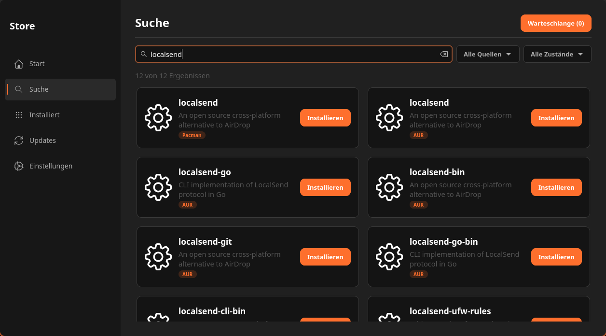
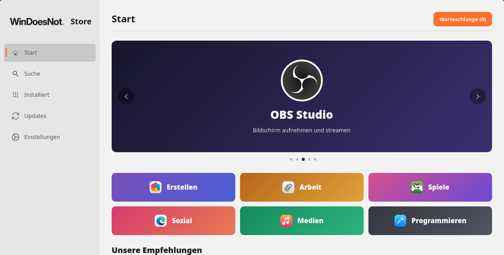

<p align="center">
  
  
</p>

# WinDoesNot Store

The app store of the [WinDoesNot](https://windoesnot.me) desktop: curated
recommendations, search across the Arch/CachyOS repositories, the AUR and
Flathub, and system updates that stay safe for a Hyprland desktop.

**[Deutsch weiter unten](#deutsch)**


| Search | Light mode |
|---|---|
|  |  |

> Status: early preview (0.3.0; numbering continues after Aurora 0.1.14). It is developed for WinDoesNot and tested
> there; on other Arch-based systems it runs, but the desktop integration
> (accent colour, light/dark, language) only applies with WinDoesNot.

## Features

- **Home page** with a banner carousel, category tiles and curated picks.
  Apps installed via pacman or as a Flatpak are marked as installed.
- **Search** in the official/CachyOS repositories, the AUR (paru or yay) and
  Flathub, ordered by relevance, with real app icons: icon theme, AppStream
  catalogues (`archlinux-appstream-data`, Flathub) or a letter tile.
- **Safe updates:** updates are only applied as a whole (`pacman -Syu`).
  Updating single packages is a partial upgrade on Arch and can break
  software built against exact library versions (e.g. Hyprland plugins).
- **Privileged operations** go through a small helper started with `pkexec`
  that only accepts an allowlist of pacman operations.
- **WinDoesNot integration:** accent colour and light/dark mode follow the
  desktop settings live; the interface is German or English depending on
  the desktop or system language.
- **Start menu integration:** `windoesnot-store --open-desktop /path/to/app.desktop`
  opens the installed app's details page, including when Store is already open.
  Removal still requires a separate action and review in Store.

### Hyprland update compatibility

The installed `windoesnot-plugins` package declares a dependency on the exact
Hyprland upstream version and package release it was built against (CPU-level
rebuild suffixes are allowed). The Store performs full upgrades through pacman,
so pacman refuses a newer incompatible Hyprland package while that plugin
package is installed. This is a package dependency gate, not a separate Store
switch or an automatic compatibility test of every desktop tool.

Before publishing a Hyprland update for WinDoesNot, rebuild and test the
plugins against the new image's Hyprland headers, port and verify affected
desktop tools, and publish matching WinDoesNot component packages in the
signed update repository. Then the full upgrade can proceed together. A user
who removes the plugin package or bypasses pacman dependencies also removes
this protection.

## Build and install

Requirements: `gtk4`, `libadwaita`, `polkit`, `appstream`; for building
`cargo` and `clang`. Optional: `archlinux-appstream-data`, `flatpak`, `paru`
or `yay`.

```sh
cargo build --release --locked
cargo test --release --locked
```

A `PKGBUILD` is included (`makepkg -si`). It installs the app, the helper,
the polkit policy, the desktop entry and the AppStream metadata.

## Credits and licence

WinDoesNot Store is a fork of [Aurora](https://github.com/ahmoodio/aurora) by
ahmoodio. Thank you for the solid foundation.

MIT licence, see [LICENSE](LICENSE). App names, icons and screenshots shown
in the store belong to their respective projects.

---

## Deutsch

Der App-Store des [WinDoesNot](https://windoesnot.me)-Desktops: kuratierte
Empfehlungen, Suche in den Arch-/CachyOS-Paketquellen, im AUR und auf Flathub
sowie Systemupdates, die für einen Hyprland-Desktop sicher bleiben.

> Stand: frühe Vorschau (0.3.0; die Nummerierung setzt nach Aurora 0.1.14 fort). Entwickelt und getestet für WinDoesNot; auf
> anderen Arch-basierten Systemen läuft der Store ebenfalls, die
> Desktop-Anbindung (Akzentfarbe, Hell/Dunkel, Sprache) greift aber nur unter
> WinDoesNot.

### Funktionen

- **Startseite** mit Banner-Karussell, Kategorie-Kacheln und Empfehlungen.
  Bereits per pacman oder als Flatpak installierte Apps werden markiert.
- **Suche** in den offiziellen bzw. CachyOS-Paketquellen, im AUR (paru oder
  yay) und auf Flathub, nach Relevanz sortiert und mit echten App-Symbolen:
  Iconset, AppStream-Kataloge (`archlinux-appstream-data`, Flathub) oder eine
  Buchstabenkachel.
- **Sichere Updates:** Updates werden nur vollständig eingespielt
  (`pacman -Syu`). Einzelne Pakete zu aktualisieren ist unter Arch ein
  Teil-Upgrade und kann Software beschädigen, die gegen genaue
  Bibliotheksversionen gebaut ist (z. B. Hyprland-Plugins).
- **Root-Rechte** laufen über einen kleinen Helfer, der per `pkexec` startet
  und nur freigegebene pacman-Operationen annimmt.
- **WinDoesNot-Anbindung:** Akzentfarbe sowie Hell/Dunkel folgen live den
  Desktop-Einstellungen; die Oberfläche ist je nach Desktop- oder
  Systemsprache deutsch oder englisch.
- **Startmenü-Anbindung:** `windoesnot-store --open-desktop /pfad/zur/app.desktop`
  öffnet die Detailseite einer installierten App, auch bei laufendem Store.
  Entfernen erfordert weiterhin eine separate Aktion und Prüfung im Store.

### Kompatibilität bei Hyprland-Updates

Das installierte Paket `windoesnot-plugins` verlangt genau die Hyprland-Version
und Paketrevision, gegen die es gebaut wurde (CPU-spezifische Neubau-Suffixe
sind erlaubt). Der Store führt vollständige Updates über pacman aus. Solange
kein passendes neues Plugin-Paket verfügbar ist, lehnt pacman ein inkompatibles
Hyprland-Update ab. Das ist eine Paketabhängigkeit, kein eigener Store-Schalter
und keine automatische Prüfung aller Desktop-Werkzeuge.

Vor der Freigabe eines Hyprland-Updates müssen die Plugins mit den Headern der
neuen Image-Version gebaut und getestet, betroffene Desktop-Werkzeuge angepasst
und passende WinDoesNot-Komponenten im signierten Update-Repository
veröffentlicht werden. Erst dann kann das vollständige Update gemeinsam
erfolgen. Wer das Plugin-Paket entfernt oder Paketabhängigkeiten umgeht,
entfernt auch diese Sperre.

### Bauen und installieren

Benötigt `gtk4`, `libadwaita`, `polkit` und `appstream`, zum Bauen `cargo` und
`clang`. Optional: `archlinux-appstream-data`, `flatpak`, `paru` oder `yay`.

```sh
cargo build --release --locked
cargo test --release --locked
```

Ein `PKGBUILD` liegt bei (`makepkg -si`). Es installiert App, Helfer,
polkit-Richtlinie, Desktop-Eintrag und AppStream-Metadaten.

### Herkunft und Lizenz

Der WinDoesNot Store ist ein Fork von [Aurora](https://github.com/ahmoodio/aurora)
von ahmoodio. Danke für die solide Grundlage.

MIT-Lizenz, siehe [LICENSE](LICENSE). Im Store gezeigte App-Namen, Symbole und
Screenshots gehören den jeweiligen Projekten.
